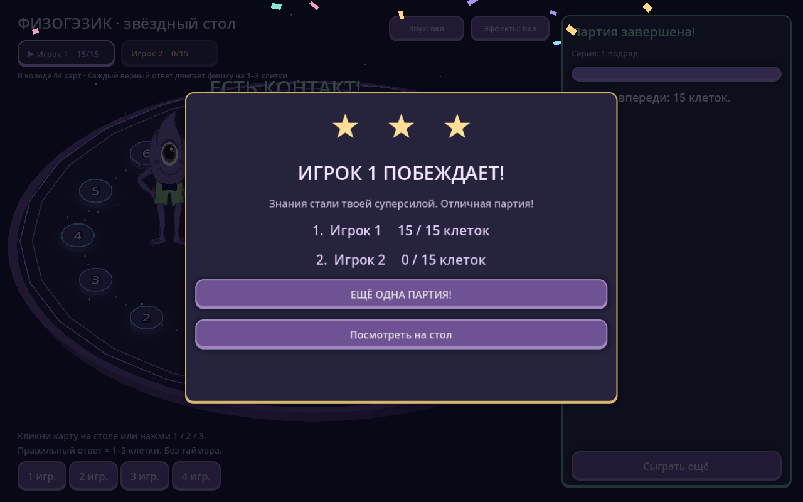

# Физогэзик — звёздный 3D-стол на Godot

Самостоятельная 3D-настолка с оригинальными правилами: закрытая карта, ответ, движение на 1–3 клетки и следующий игрок. Проект использует настоящую 3D-сцену, а игровая обратная связь вынесена отдельно в `game_fx.gd`.

## Игровые эффекты

- Космическая атмосфера: светящийся овальный стол, цветные орбиты клеток, звёздные частицы и подсветка активного игрока.
- Карты плавают над столом, поднимаются при наведении, вылетают и переворачиваются. На лице карты напечатаны тема, вопрос и стоимость.
- Фишки с глазами прыгают по каждой клетке, сжимаются перед прыжком и пружинят при посадке. Посадки сопровождаются кольцами света, искрами и короткими нотами.
- Физогэзик реагирует на успех и ошибку. Успех даёт всплывающую награду, серию, цветовой отклик панели и небольшой импульс камеры; ошибка — тёплую реакцию без потери клеток.
- Победа: фейерверк, конфетти, звёзды, музыкальная фраза и отдельное окно с результатами.
- Звук синтезируется самой игрой. Кнопки «Звук» и «Эффекты» меняют представление, сохраняя точное начисление клеток.

## Запуск

Откройте `project.godot` в **Godot 4.5 или новее** и нажмите **F6/F5** (главная сцена — `main.tscn`). Также можно запустить `Играть 3D.cmd`: он использует `GODOT_EXE`, `Godot.exe` рядом с проектом, Godot из PATH или редактор, подготовленный в этой рабочей сессии.

На компьютере разработки проект проверен в Godot **4.5.1 stable**. Редактор загружен отдельно во временную папку; он не включён в архив исходного проекта.

Командный запуск:

```sh
godot --path Godot3D
```

## Как играть

- Выберите 1–4 игроков кнопками внизу слева.
- В свой ход кликните закрытую карту на столе, нажмите 1/2/3 или кнопку справа.
- Карта перевернётся. Вопрос и варианты появятся на панели.
- Ответьте: фишка проходит ровно 1, 2 или 3 клетки по стоимости карты. При ошибке остаётся на месте.
- Прочитайте объяснение и передайте ход.
- Побеждает первый дошедший до клетки 15; если колода закончится — фишка, продвинувшаяся дальше.

Включены все 45 вопросов исходной настолки, в том числе шесть фазовых переходов. Карты не повторяются в партии.

## Что проверено

Проект импортирован и запущен в Godot 4.5.1. Автоматический smoke-сценарий проходит партию, проверяет уникальность карточек и точное движение на 1–3 клетки:

```sh
godot --headless --path Godot3D -- --smoke
```

Отдельно проверен обычный графический запуск через OpenGL Compatibility, получен снимок отрисованной 3D-сцены.

Сценарий эффектов проверяет раздачу, переворот, блокировку раннего ответа и передачи хода во время прыжков, реакцию на ошибку, победу, сброс анимаций при новой партии и режим уменьшенных эффектов:

```sh
godot --headless --path Godot3D -- --effects-test
python tools/check_godot.py --godot godot --screenshots
```



## Журнал

`journal.gd` ведёт `user://logs/game.log`. Файл очищается каждый час, в том числе при входе в новый час после перезапуска. Постоянное стандартное файловое логирование движка отключено, чтобы не накапливать параллельные журналы. Очистка журнала не меняет счёт, очередь или фазу игры.

Основная веб-версия содержит сетевые комнаты, телефоны, математическую вёрстку и сохранения. Этот 3D-проект предназначен для игры за одним компьютером и дальнейшей визуальной разработки стола.

## Файлы

- `project.godot`, `main.tscn`, `main.gd` — проект и сцена.
- `game_fx.gd` — частицы, звук, реакции, световые волны и награды.
- `journal.gd` — почасовой журнал.
- `data/questions.json` — банк из основной веб-версии.
- `assets/` — исходный Физогэзик и рубашка карт.

Повторная подготовка банка и графики из корня веб-проекта: `python tools/prepare_godot.py`. Она также скачивает официальный portable-редактор Godot 4.5.1 во временный каталог, без глобальной установки.
