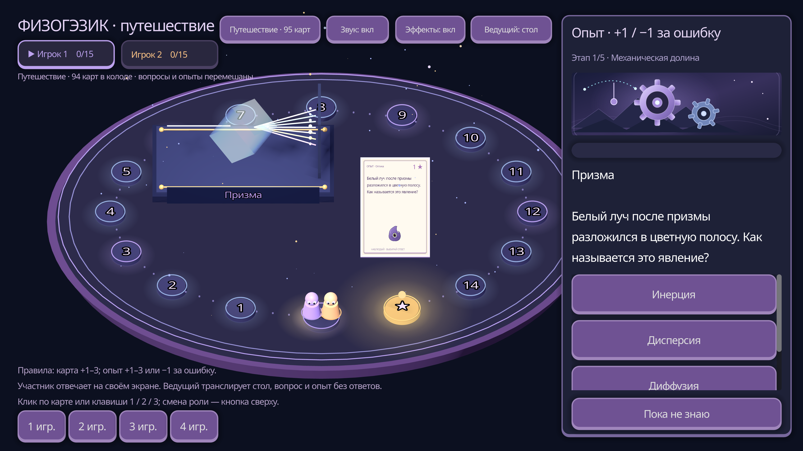

# Физогэзик — 3D-путешествие на Godot

Самостоятельная 3D-настолка с оригинальными правилами: закрытая карта, ответ, движение на 1–3 клетки и следующий игрок. Проект использует настоящую 3D-сцену, а игровая обратная связь вынесена отдельно в `game_fx.gd`.

## Лаборатория и 4K

- Самостоятельная игра работает как путешествие: 45 исходных вопросов и 50 опытов всегда перемешаны в одной колоде из 95 карт. Маршрут проходит пять тематических этапов; отдельно включать лабораторию не нужно.
- У каждого этапа есть собственная SVG-обложка 1200×400, палитра стола и объёмная анимированная эмблема: шестерни, тепловые волны, электрический разряд, призма и атомные орбиты. Смена этапа сопровождается плавной карточкой-переходом, не блокирующей правила.
- Все 50 опытов имеют собственные объёмные установки в `lab_stage.gd`: механика, тепловые процессы, электрические цепи, оптика и атомные явления. Это настоящие MeshInstance3D с PBR-материалами и анимацией, а не SVG или плоские картинки.
- Во время хода видны вопрос и четыре перемешанных варианта. Правильный ответ не подсвечивается; объяснение открывается только после выбора или пропуска.
- За верный ответ начисляется `+level`, за ошибку в опыте — `−1` с анимированным возвратом фишки. Счёт не опускается ниже нуля. Обычные карты по-прежнему не имеют штрафа.
- Проект настроен на окно 3840×2160, 4× MSAA, анизотропную фильтрацию и текстуры лицевой стороны карты 1280×1792. MSDF-шрифты с мипмапами остаются чёткими при масштабировании. Физогэзик, рубашка карт и знак успеха заменены настоящими SVG-ассетами, которые Godot растрирует с запасом под 4K; световой ореол использует SVG 512×512 и плавный радиальный градиент. Автоматические снимки используют отдельный 4K-буфер, поэтому имеют 3840×2160 даже на экране меньшего разрешения.
- WebGL использует адаптивный буфер: его внутреннее разрешение соответствует размеру области игры и плотности пикселей экрана, включая полноэкранный 4K-режим, вместо растягивания фиксированного кадра 1280×720.
- «Эффекты: выкл» останавливает декоративное движение и анимацию опытов, но сохраняет сцену, вопрос и правила.

## Игровые эффекты

- Космическая атмосфера: светящийся овальный стол, цветные орбиты клеток, 52 пылинки у стола и 96 мерцающих звёзд двумя слоями глубины, подсветка активного игрока.
- Финиш зовёт издалека: пульсирующее золотое сияние клетки и парящий над ней огонёк.
- Карты плавают над столом, поднимаются при наведении, вылетают и переворачиваются. На лице карты напечатаны тема, вопрос и стоимость.
- Фишки с глазами прыгают по каждой клетке, сжимаются перед прыжком и пружинят при посадке. Посадки сопровождаются кольцами света, искрами и короткими нотами.
- Физогэзик реагирует на успех и ошибку. Успех даёт всплывающую награду, серию, цветовой отклик панели и небольшой импульс камеры; ошибка — тёплую реакцию, лёгкую встряску и ответ без потери клеток.
- Звук синтезируется самой игрой: двухслойная волна с субоктавой и случайная расстройка высоты ±4 % против привыкания.
- Победа: фейерверк, конфетти, звёзды, музыкальная фраза и отдельное окно с результатами.
- Звук синтезируется самой игрой. Кнопки «Звук» и «Эффекты» меняют представление, сохраняя точное начисление клеток.

## Запуск

Откройте `project.godot` в **Godot 4.5 или новее** и нажмите **F6/F5** (главная сцена — `main.tscn`). Также можно запустить `Играть 3D.cmd`: он использует `GODOT_EXE`, `Godot.exe` рядом с проектом, Godot из PATH или редактор, подготовленный в этой рабочей сессии.

На компьютере разработки проект проверен в Godot **4.5.1 stable**. Редактор загружен отдельно во временную папку; он не включён в архив исходного проекта.

Командный запуск:

```sh
godot --path Godot3D
```

## Как играть

- Выберите 1–4 путешественников кнопками внизу слева. Лаборатория уже входит в общую колоду.
- **Ведущий на ПК:** кнопка «Ведущий: стол» открывает общий стол с маршрутом, фишками, очками и этапами. После хода участника на общем экране появляются исходный вопрос и 3D-лаборатория для трансляции всем. Варианты, объяснение и правильный ответ на экране ведущего не показываются.
- **Участник:** кнопка «Участник: карты» возвращает карточки, варианты ответов и 3D-опыты. На телефоне и планшете включается портретная компоновка: крупная карта или установка сверху, вопрос и сенсорные ответы снизу; видеть общий стол не требуется. Переключение роли сохраняет текущий ход и открытую карту. Это локальное переключение представлений на одном устройстве, не сетевая комната.
- В свой ход кликните закрытую карту на столе, нажмите 1/2/3 или кнопку справа. Заранее неизвестно, будет это вопрос или опыт.
- Карта перевернётся. Вопрос и варианты появятся на панели; у опыта также откроется объёмная установка.
- Ответьте: фишка проходит ровно 1, 2 или 3 клетки по стоимости карты. При ошибке в обычной карте она остаётся на месте, а в опыте возвращается на одну клетку, но не дальше старта.
- Прочитайте объяснение и продолжите путь. Каждые три клетки открывают следующий этап маршрута.
- Побеждает первый дошедший до клетки 15; если колода закончится — фишка, продвинувшаяся дальше.

Включены все 45 вопросов исходной настолки, в том числе шесть фазовых переходов, и 50 новых опытов. Карты не повторяются в партии.

## Что проверено

Проект импортирован и запущен в Godot 4.5.1. Smoke-сценарий проходит исходную партию, проверяет уникальность карточек и точное движение на 1–3 клетки. Лабораторный сценарий создаёт каждую из 50 сцен, проверяет фактическое изменение трансформаций, скрытые варианты, общую колоду и границы счёта. Сценарий путешествия проверяет пять обложек, пять объёмных эмблем и переключение ведущего/участника без потери открытого опыта:

```sh
godot --headless --path Godot3D -- --smoke
godot --headless --path Godot3D -- --lab-test
godot --headless --path Godot3D -- --journey-test
```

Сценарий эффектов проверяет раздачу, переворот, блокировку ввода, прыжки, победу, перезапуск, уменьшенные эффекты и настоящий анимированный шаг назад при штрафе:

```sh
godot --headless --path Godot3D -- --effects-test
python tools/check_godot.py --godot godot --screenshots
```



Восемнадцать состояний, включая пять лабораторных установок, пять обложек этапов, общий стол и общий опыт ведущего, отрендерены в **3840×2160** и сохранены в `../docs/images/godot-4k/`. Скрипт проверяет размер каждого PNG, а также отсутствие ошибок Godot. Реальный WebGL дополнительно проверяется на телефонах 360×800 и 390×844, планшете 768×1024, десктопах и 4K; отдельно подтверждаются мобильный ввод и отсутствие ответов на общем экране.

## Журнал

`journal.gd` ведёт `user://logs/game.log`. Файл очищается каждый час, в том числе при входе в новый час после перезапуска. Постоянное стандартное файловое логирование движка отключено, чтобы не накапливать параллельные журналы. Очистка журнала не меняет счёт, очередь или фазу игры.

Основная веб-версия содержит сетевые комнаты, телефоны, математическую вёрстку и сохранения. В 3D-проекте режимы ведущего и участника переключаются локально на одном устройстве; синхронизации между телефоном ученика и компьютером учителя пока нет.

## Файлы

- `project.godot`, `main.tscn`, `main.gd` — проект, сцена, колода и правила.
- `lab_stage.gd` — 50 объёмных анимированных экспериментов, без доступа к правильному ответу.
- `game_fx.gd` — частицы, звук, реакции, световые волны, переходы этапов и награды.
- `journey_art.gd` — пять объёмных эмблем и орбитальные частицы этапов.
- `journal.gd` — почасовой журнал.
- `data/questions.json`, `data/experiments.json` — оба банка карт.
- `assets/` — SVG Физогэзика, рубашки, пять обложек и световые градиенты.

Повторная подготовка банков и графики из корня веб-проекта: `python tools/prepare_godot.py`. Она также скачивает официальный portable-редактор Godot 4.5.1 во временный каталог, без глобальной установки.
