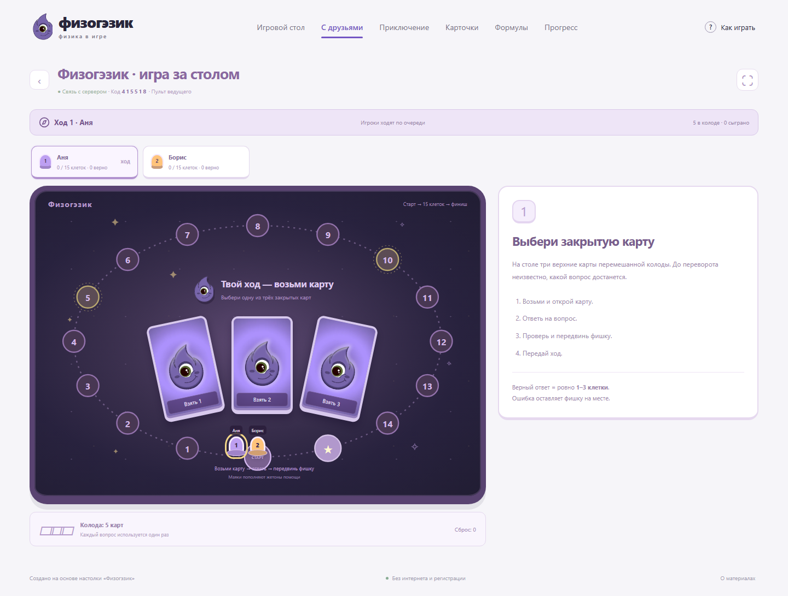
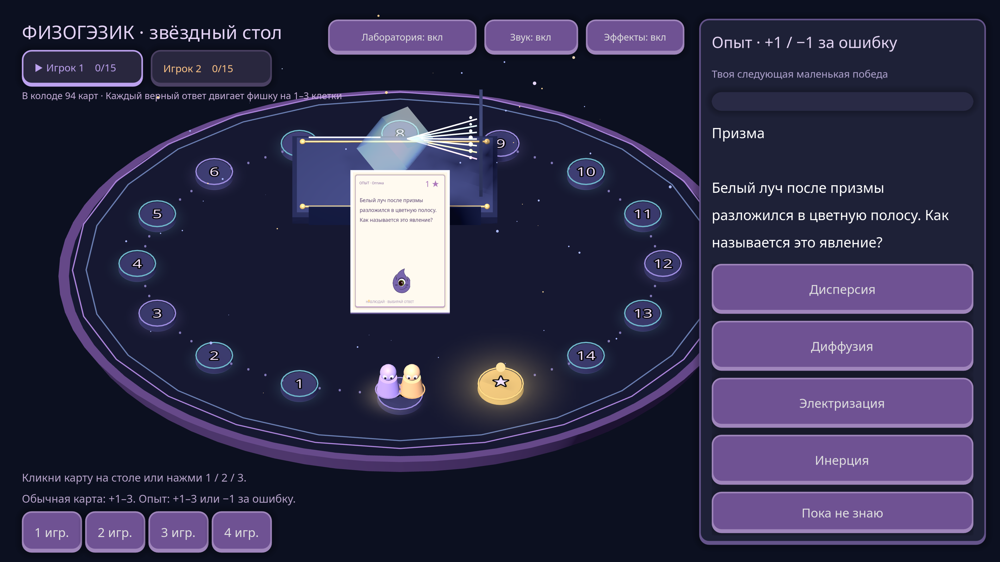

# Физогэзик — настолка, веб и звёздный 3D-стол

Браузерная настолка для подготовки к ОГЭ по физике. В центре — настоящее игровое поле, фишки, перемешанная колода, выбор закрытой карты, её переворот и передача хода. Подключение телефонов работает вокруг того же игрового стола. Рядом доступны приключение, тренировка и справочник.



## GitHub: публикация и запуск

Подготовлен репозиторий **Altersam/physogezic**. После загрузки файлов включите **Settings → Pages → Source → GitHub Actions**. Workflow `Publish web game` проверит правила и опубликует сайт по адресу **https://altersam.github.io/physogezic/**.

Для игры с телефонами запустите Node.js-сервер локально или в **GitHub Codespaces**: откройте Codespace, выполните `npm start` и сделайте порт 4173 доступным участникам. QR автоматически подхватит адрес Codespaces. На GitHub Pages работает статическая игра за одним экраном; комнаты используют отдельный сервер.

Пошаговая инструкция — **[GITHUB.md](GITHUB.md)**. Настроены проверки веба и Godot, публикация Pages, окружение Codespaces и Docker-запуск.

## Запуск

**Начать играть:** откройте `index.html` двойным щелчком или запустите `Играть.cmd` в Windows. Откроется поле настолки. Нужен современный Chrome, Edge, Firefox или Safari. На одном экране можно играть одному или компанией без интернета и установки зависимостей.

**Та же настолка с телефонов:** запустите `Сетевая игра.cmd` или выполните `npm start` в папке игры. Нужен Node.js 20+; дополнительные npm-пакеты устанавливать не требуется. Откройте вкладку «С друзьями», создайте стол и покажите участникам его QR/код. Устройства открывают один адрес сервера, например по общему Wi-Fi. Подробности — в `NETWORK.md`.

Для передачи игры есть архив **`Физогэзик — игра.zip`**. Распакуйте его целиком и откройте `index.html` внутри папки. Оригинальные документы в архив игры не входят.

Другой способ — локальный сервер с Node.js:

```sh
npm start
```

Откройте **http://localhost:4173**. Остановить сервер: `Ctrl+C` в его окне. Другой порт: переменная окружения `PORT`. По умолчанию сервер доступен в локальной сети; в лобби можно выбрать адрес для игроков. Для доступа только с этого компьютера задайте `HOST=127.0.0.1`.

## Что есть в игре

### Лаборатория: 50 анимированных опытов

- Отдельный переключатель «Лаборатория» добавляет к исходным 45 вопросам **50 новых карт** — всего 95 в локальной партии.
- По 10 опытов на каждую из пяти тем: механика, тепловые явления, электричество, оптика и квантовые явления.
- У каждой карты собственная игровая SVG-сцена: движутся маятники, тела и тележки, кипит вода, работают цепи, проходят световые лучи, вращаются электроны и происходят ядерные превращения.
- Верный ответ приносит **+1/+2/+3 балла** по сложности; ошибка или пропуск опыта отнимает **1 балл**, но счёт никогда не становится отрицательным. Обычные вопросы остаются без штрафа.
- Опыты можно отдельно рассмотреть в библиотеке через «Только опыты». Они участвуют в поиске, статистике, повторении ошибок, резервном копировании и режиме с ведущим.
- Анимации отключаются системной настройкой уменьшения движения. Лаборатория работает без интернета; сетевые комнаты используют исходные 45 вопросов. Godot-версия поддерживает все 95 карт и объёмные 3D-опыты.

### Единый игровой стол

- Поле на 15 клеток, как в оригинале, или длинная партия на 30 клеток.
- Игроки ходят по очереди. Ходящий выбирает одну из трёх закрытых карт на столе.
- Карта переворачивается в центре поля: становятся видны вопрос, тема и стоимость.
- Правильный ответ двигает фишку **ровно на 1, 2 или 3 клетки**, согласно карте. В исходной колоде ошибка и пропуск оставляют её на месте; в «Лаборатории» действует описанный выше штраф.
- После проверки карта уходит в сброс, фишка проходит клетки по маршруту, ход передаётся следующему игроку.
- Основной вариант: отвечает ходящий. Дополнительный: карту открывают по очереди, а на неё отвечают все участники.
- Проверка автоматическая либо ведущий сверяет ответы своими словами с эталоном.
- Жетон помощи убирает два неверных варианта. Его использование не меняет стоимость карты. Маяки пополняют запас жетонов.
- Побеждает первый дошедший до финиша; при окончании колоды — тот, кто продвинулся дальше.

### Подключение к тому же столу

- Пульт ведущего, шестизначный код, QR и ссылка-приглашение.
- До 40 игроков или команд; каждый отвечает со своего телефона или компьютера.
- Игрок берёт карту и отвечает со своего устройства. Другие видят ту же карту и те же фишки на общем поле.
- Ведущий видит, чей ход, кто ответил, и может помогать брать карты, проверять ответы и передавать ход.
- Вопрос появляется только после выбора закрытой карты; по умолчанию таймер отключён.
- Серверная проверка ответа, запрет повторного начисления, восстановление участника после перезагрузки.
- Комнаты сохраняются в `data/rooms.json` и восстанавливаются после перезапуска сервера. Этот файл автоматически создаётся при первой комнате; в архив игры он не входит.
- Экспорт общей таблицы в CSV и однократная награда игроку в личный прогресс.

Механика подключения адаптирована из вашего проекта `Z:\YandexDisk\Obsidian\Alterna\Сайт\quiz`: пульт, код/QR, имя и идентификатор устройства, ожидание ведущего, счётчик ответов и серверная проверка.

Вариант «Викторина без очереди» остаётся отдельной настройкой для занятий. По умолчанию создаётся настольная партия с полем и картами.

### Математическая вёрстка и анимации

- Справочник расширен до 20 разделов с условиями применения формул и единицами СИ.
- Формулы в карточках, ответах, объяснениях, справочнике и сетевой игре отображаются через локальный MathML: настоящие дроби, индексы, степени и векторные стрелки.
- Уточнены работа силы при угле α, тепловой баланс нагрева/охлаждения, смысл обозначений сопротивления и плотности, расстояния линзы и условия динамических формул.
- Добавлены анимации карты, сундуков, звёзд, наград и комбо; световые лучи, пар, свечение лампы и движение атомной модели.
- В сетевой игре корабли перелетают между станциями, меняются события раунда, показываются получение ответа и итоговые места. Системная настройка уменьшения движения отключает эффекты.

### Приключение

- **5 островов, 20 миссий и 5 боссов.** Миссии открываются последовательно, лучшие звёзды сохраняются.
- **5–6 заданий в миссии:** вопросы перемежаются с управляемыми опытами.
- **Пять лабораторий:** сила двигателя тележки, нагрев воды, ток в цепи с выключателем, фокусировка линзы и β⁻-распад ядра.
- **5 жизней на миссию**, подсказка и энергетический щит. Ошибочное задание возвращается в конец очереди. Новая попытка сразу восстанавливает жизни.
- **Опыт, уровни, комбо, звёзды**, кристаллы и одноразовые сундуки островов.
- **Задания дня и серия дней** с завершёнными миссиями. Учёт по локальной дате компьютера.
- **Мастерская с тремя образами** Физогэзика за игровые кристаллы.
- **Режим исследования** без потери жизней. Подсказки, звуки и эффекты не обязательны для прохождения.
- **Автосохранение приборов и ответов:** даже положение экрана линзы и выключателя сохраняется после перезагрузки.

За верный ответ — 10 XP; за исправление ошибки — 5 XP. С третьего верного ответа подряд — бонус 5 XP. Первое прохождение даёт ещё 25 XP и 15 кристаллов; босс — 50 XP и 35 кристаллов. Сундук острова приносит 30 кристаллов один раз. Три звезды — без ошибок, две — до двух ошибок, одна — за завершение. Косметика не меняет ответы или характеристики задач.

### Звёздный стол на Godot

В `Godot3D/project.godot` находится самостоятельный 3D-вариант за одним компьютером. Он поддерживает исходные 45 вопросов и режим «Лаборатория» со всеми 95 картами. Проект запущен и проверен в Godot 4.5.1. Откройте проект в Godot и нажмите F5 либо используйте `Godot3D/Играть 3D.cmd`.

- **50 настоящих объёмных опытов:** механические установки, жидкости и пар, электрические цепи, световые лучи, атомы и ядерные превращения. Все сцены анимированы и создаются в `lab_stage.gd`.
- Вопрос сопровождается четырьмя перемешанными вариантами без подсветки правильного. После ответа появляется объяснение.
- Верный ответ двигает фишку на 1–3 клетки. Ошибка в опыте возвращает её на одну клетку с анимацией, но не ниже старта; обычные вопросы штрафа не имеют.
- Светящийся овальный стол, цветные клетки, мягкие ореолы, звёздная пыль и живые фишки с глазами.
- Карты поднимаются под курсором, вылетают из колоды, переворачиваются и показывают напечатанный вопрос на 3D-поверхности.
- Победа отмечается конфетти, звёздами, фанфарой и отдельным экраном результатов.
- Режим 3840×2160, 4× MSAA, анизотропная фильтрация и текстуры карт повышенного разрешения. Одиннадцать проверочных кадров сохранены в `docs/images/godot-4k/`.
- Звук и эффекты можно выключить. Отключение эффектов останавливает анимации, но не меняет правила и доступность карты.



Подробности — **[Godot3D/README.md](Godot3D/README.md)**. Исходный проект также упаковывается в отдельный архив.

### Почасовые журналы

`data/logs/runtime.log` у сервера и `user://logs/game.log` у Godot обнуляются каждый час. Панели последних ходов показывают только текущий час. Состояние поля, очередь, принятые ответы и результаты хранятся отдельно от очищаемого журнала.

### Настольный режим

Открывается главной страницей или вкладкой «Игровой стол»; поле и карты общие для игры на одном экране и через телефоны.

- 45 карточек: 20 на 1 балл, 15 на 2 балла, 10 на 3 балла.
- Пять тем: механика, тепловые явления, электричество, оптика, квантовые явления.
- Одиночная игра и 2–4 игрока или команды за одним устройством.
- Фишки на поле из 15 шагов. Правильный ответ продвигает на стоимость карточки, ошибка не отнимает очки.
- Партия до 15 баллов или до конца колоды с движением по кругу. При окончании короткой колоды выигрывает максимальный результат; при равенстве очков — ничья.
- Автоматическая проверка вариантов и шести фазовых переходов, объяснение после каждого ответа.
- Режим с ведущим: открытый вопрос, собственный ответ, раскрытие эталона и ручная оценка.
- Выбор тем и сложности, перемешивание без повторов в партии.
- Сохранение партии, статистика по темам, повторение ошибок.
- Справочник формул и просматриваемая колода с поиском.
- Скачивание результата партии и резервной JSON-копии прогресса с восстановлением.
- Адаптивный интерфейс, клавиатурное управление и отключаемые звуки.

Сохранение локально для браузера и адреса запуска. Открытый файл и локальный сервер имеют разные хранилища. Для переноса используйте «Мой прогресс → Сохранить копию / Загрузить копию». В приватном режиме данные могут исчезать при закрытии браузера.

## Адаптация исходников

Изучены все восемь исходных файлов. Сохранены распределение вопросов, механика, персонаж и характерная фиолетовая палитра. Треугольник из `печать.треугольник.docx` реализован как сопоставление шести переходов. Исходные документы оставлены в папке.

Для автопроверки открытые вопросы переработаны в карточки с вариантами; формулировки для ведущего хранятся отдельно. Физические неточности исходного ключа исправлены: способы изменения внутренней энергии, агрегатное состояние NaOH, способы электризации, энергия системы при столкновении, условия опыта с пробиркой, связь скорости звука с упругостью и плотностью, формулы перемещения и скорости. Подробности — кнопка «О материалах» внизу игры.

Это тематическая учебная игра по исходной колоде, а не полный экзаменационный тренажёр с официальной оценкой ОГЭ.

## Устройство проекта

| Файл | Назначение |
| --- | --- |
| `index.html` | Точка входа, оболочка, навигация и диалоги |
| `styles.css` | Оформление и мобильная адаптация |
| `questions.js` | 45 исходных вопросов, объяснения, темы и справочник |
| `experiments.js`, `lab.js`, `lab.css` | 50 опытов, их SVG-сцены и CSS-анимации |
| `engine.js` | Колода, очередность, баллы, штрафы, проверка и окончание игры |
| `campaign.js` | Острова, миссии, опыты, жизни, награды и прогресс |
| `adventure-ui.js` | Карта, уроки, модели приборов, боссы и мастерская |
| `adventure.css` | Тактильные игровые элементы и эффекты |
| `app.js` | Интерфейс, локальное сохранение, статистика, экспорт |
| `assets/` | Графика, подготовленная из исходных материалов |
| `server.cjs` | HTTP-сервер, сетевые API, QR, адреса подключения и сохранение комнат |
| `room-engine.cjs` | Серверные правила комнат, участников, раундов и движения |
| `room-ui.js`, `rooms.css` | Лобби, телефоны игроков, пульт ведущего и поле на 30 станций |
| `table-engine.cjs` | Серверные правила настолки, колода, очередь, проверка ведущим и точные шаги |
| `table-view.js`, `table.css` | Единое поле, физические карточки, переворот, фишки, сброс и жетоны |
| `math.js`, `math.css` | Локальная математическая вёрстка MathML |
| `motion.css` | Анимации и режим уменьшения движения |
| `journal.cjs`, `journal.js` | Почасовая очистка технического журнала и панелей ходов |
| `vendor/` | Встроенный QR-генератор с MIT-лицензией |
| `tests/engine.test.cjs`, `tests/experiments.test.cjs` | Проверки правил, исходной колоды и 50 опытов |
| `tools/check_browser.py` | Сквозная проверка Chromium через Playwright |
| `tools/check_experiments.py` | Полная партия из 50 опытов, анимации, баллы и мобильный экран |
| `tools/check_adventure.py` | Прохождение всех 20 миссий, проверка опытов, наград и сохранения |
| `tools/check_rooms.py` | Ведущий и два игрока, восстановление комнаты, CSV и математическая вёрстка |
| `tools/check_table.py` | Полная настольная партия с двумя телефонами, общей картой и ведущим |
| `tools/check_godot.py` | Настоящий запуск Godot: правила, анимации, перезапуск и графические снимки |
| `tools/build_site.py` | Сборка статической версии для GitHub Pages |
| `.github/workflows/` | Публикация Pages и проверки веб/Godot |
| `tools/balance.cjs` | Воспроизводимая симуляция баланса |
| `GAME-DESIGN.md` | Механики, параметры баланса и использованные игровые скиллы |
| `tools/prepare_assets.py` | Повторное извлечение графики и текста |

Одиночное приключение и режим за одним экраном работают на статическом хостинге: нужны `index.html`, клиентские JS/CSS и `assets/`. Для сетевых комнат запускается Node.js-сервер с `room-engine.cjs` и встроенным QR-генератором. Сборки и внешней базы данных нет.

### Проверка

```sh
npm test
```

Для браузерной проверки нужны Python, Playwright и установленный Chromium:

```sh
python tools/check_browser.py
python tools/check_experiments.py
python tools/check_adventure.py
python tools/check_rooms.py
python tools/check_table.py
python tools/check_godot.py --godot godot
python tools/build_site.py
npm run balance
```

Сценарий запускает и останавливает локальный сервер, проходит партии, проверяет восстановление, четыре фишки, сопоставление, ведущего, мобильную вёрстку и прямое открытие файла. Путь снимков выводится после запуска. Для повторного извлечения материалов: `python tools/prepare_assets.py` (нужны `python-docx`, `pymupdf`, `Pillow`). Для самой игры Python не нужен.

### Использованные открытые руководства

- [MDN: техники разработки браузерных игр](https://developer.mozilla.org/en-US/docs/Games/Techniques).
- [Anthropic Skills: Frontend Design](https://github.com/anthropics/skills/tree/main/skills/frontend-design).
- [Anthropic Skills: Webapp Testing](https://github.com/anthropics/skills/tree/main/skills/webapp-testing).
- [Yuki001/game-dev-skills: game-architect](https://github.com/Yuki001/game-dev-skills/tree/main/skills/game-architect) — разделение правил, контента и эффектов.
- [Yuki001/game-dev-skills: game-design-review](https://github.com/Yuki001/game-dev-skills/tree/main/skills/game-design-review) — мотивация, восстановление после ошибок, понятные награды и обратная связь.
- [Yuki001/game-dev-skills: game-balance-analysis](https://github.com/Yuki001/game-dev-skills/tree/main/skills/game-balance-analysis) — расчёт жизней, опыта и наград с исполняемой симуляцией.
